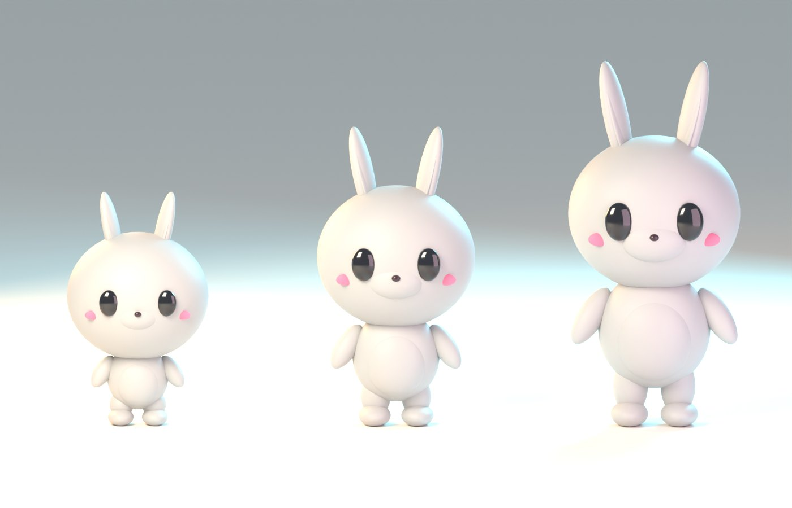
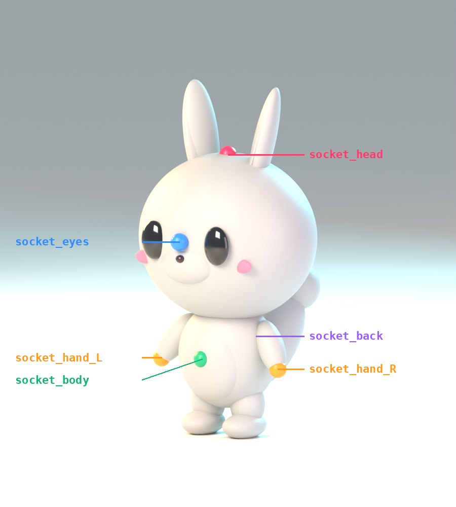

# Aşama 0A — Ortak şablon

12 pet'in ortak kuralları. Bu doküman bir insan sanatçıya ya da yapay zekâ ile 3D üretim + temizlik hattına aynen verilebilir.
Kaynak: `art/scripts/pets.py` (betikli blockout), `art/scripts/render.py` (render), `art/scripts/measure.py` (ölçüler).



## 1. Ölçek ve oran
- 1 Unity birimi = 1 metre. Ön yüz −Y (Blender) → Unity'de +Z ileri (FBX dışa aktarımında "Forward: -Y, Up: Z" + "Apply Transform").
- Pet ayakları z = 0'da, pivot ayakların ortasında.
- Chibi oran: kafa, kafa üstüne kadar olan boyun ~%55–65'i. Brief'teki "kafa ≈ yarı boy" hedefinin biraz üstündeyiz: referans stildeki şişkin "designer toy" hissi bu oranda daha güçlü.

| Evre | Ölçek | Kafa | Gövde | Bacak | Kafa üstüne kadar boy (Pofi) | Kafa oranı |
|---|---|---|---|---|---|---|
| Yavru (Sv 1–4) | ×0.80 | ×1.12 | ×0.88 | ×0.85 | 0.56 m | %67 |
| Genç (Sv 5–9) | ×1.00 | ×1.00 | ×1.00 | ×1.00 | 0.70 m | %60 |
| Yetişkin (Sv 10+) | ×1.17 | ×0.93 | ×1.10 | ×1.25 | 0.85 m | %54 |

Kulak ve antenler bu boya eklenir (Pofi'nin Yetişkin evresinde kulak ucu 1.06 m). Bu nedenle oyunda kamera çerçevesi kafa üstüne göre ayarlanır.

## 2. Ortak gövde şablonu (kıyafet şablonu)
Kıyafet şablonu için gövde, kol ve bacak oranı **12 türde aynıdır** (Genç evrede):

| Parça | Değer |
|---|---|
| Bacak üstü | z = 0.12 m |
| Gövde merkezi | z = 0.20 m; yarıçap 0.13 × 0.115 × 0.135 m |
| Omuz | z ≈ 0.30 m, x = ±0.11 m |
| El (soket) | x = ±0.175, y = −0.035, z = 0.18 m |
| Kafa merkezi | z ≈ 0.495 m; yarıçap 0.235 × 0.205 × 0.21 m (türe göre ±%10) |

- Türe özel uzantılar (kuyruk, kabuk, hortum, yele, kanat kapağı, diken) **kıyafetten bağımsızdır**. Kıyafet bunlara göre şekil değiştirmez; çakışma kuralları §5'tedir.
- Ayakkabı için iki ayak şablonu:
  - **Düz ayak:** Pofi, Kurbi, Mimi, Boncuk, Piko, Fifi, Arlo, Lolo, Benli.
  - **Yüzgeç / kuş ayağı:** Mavi, Pıtı, Tosbi.

## 3. Ortak iskelet
**Öneri: Unity "Generic" rig + birebir aynı temel iskelet** (Humanoid değil). Gerekçeler:
- Chibi oranlar Humanoid kas sisteminde bozuluyor.
- 12 pet aynı hiyerarşi, kemik adları ve dinlenme pozunu paylaştığı için animasyonlar türler arasında doğrudan paylaşılır.

Türe özel kemikler, ek bir **tür katmanı** (Animator layer, additive) ile oynatılır.

```
root
└─ bone_hips
   ├─ bone_spine → bone_chest → bone_neck → bone_head
   │    bone_head ├─ bone_eye_L, bone_eye_R        (bakış)
   │              └─ [tür] bone_ear_L_01..02, bone_ear_R_01..02 | bone_trunk_01..04 | bone_antenna_L/R_01..02 | bone_mane
   │    bone_chest├─ bone_shoulder_L → bone_upperarm_L → bone_lowerarm_L → bone_hand_L   (R aynı)
   │              └─ [tür] bone_shell | bone_elytron_L, bone_elytron_R (menteşe) | bone_spikes
   ├─ bone_upperleg_L → bone_lowerleg_L → bone_foot_L   (R aynı)
   └─ [tür] bone_tail_01..03
```

Bütçe: temel iskelet 20 kemik, tür katmanı ≤ 10 kemik, köşe başına ≤ 4 etki.

## 4. Soketler
Adlar 12 türde aynıdır. Her soket bir kemiğe bağlı boş nesnedir (Unity'de `Transform`).



| Soket | Bağlı kemik | Konum (Genç) | Kullanım |
|---|---|---|---|
| `socket_head` | bone_head | kafa tepesi (+ kulak payı) | şapka, taç, kulaklık |
| `socket_eyes` | bone_head | yüz önü, göz hizası | gözlük, maske |
| `socket_body` | bone_chest | göğüs önü | kolye, rozet, kuşak tokası |
| `socket_back` | bone_chest | sırt | çanta, pelerin, kanat |
| `socket_hand_L` / `socket_hand_R` | bone_hand_L/R | avuç | olta, top, dondurma, kart |

## 5. Türe göre çakışma ve uyum kuralları (CosmeticFitSystem verisi)

Şapka varyantları: `normal`, `ear_holes` (iki kulak deliği), `center_hole` (tepe püskülü/plaka deliği), `antenna_holes`, `mane_fit` (geniş bant, yelenin içinde oturur), `raised` (kafa üstündeki çıkıntıların üstüne yükseltilmiş, ×1.1).

| Pet | Şapka | Gözlük | Gövde kıyafeti | Sırt | Not |
|---|---|---|---|---|---|
| Pofi | `ear_holes` | normal | normal | kuyruk deliği | uzun kulaklar şapkadan geçer |
| Mavi | `normal` | gaga üstü (burun köprüsü yok → klipsli varyant) | normal | normal | yüzgeç kollar: eldiven yok |
| Kurbi | `center_hole` | normal | normal | **plakaların üstüne** ofset; pelerin yok | kuyruk deliği |
| Mimi | `ear_holes` | normal | normal | normal | bıyıklar maskeyle çakışmaz (maske küçük varyant) |
| Pıtı | `center_hole` | klipsli | yalnızca **önlük** tipi (top gövde) | küçük çanta | kanat kollar: eldiven yok |
| Boncuk | `normal` (kulaklar yanda) | normal | normal | normal | — |
| Tosbi | `normal` | normal | yalnızca önlük/kolye | **kabuğun üstüne** oturur (soket kabuk tepesinde) | kabuk kıyafetle örtülmez |
| Piko | `raised` | normal | normal | **yalnızca düz/küçük** sırt eşyası; dikenlerin üstünden geçen pelerin/çanta askısı yok | |
| Fifi | `normal` | hortum üstü klipsli | normal | normal | kulaklar şapkayla örtülmez |
| Arlo | `mane_fit` | normal | normal | normal | atkı/kolye yelenin ALTINDA kalır |
| Lolo | `ear_holes` | normal | önlük / yelek (boyun püskülleri açık kalır) | normal | |
| Benli | `antenna_holes` | normal | yalnızca önlük (kanat kapaklarını örtmez) | **yok** (kanat kapakları açılıp kapanır) | |

Kural: Uyumsuz eşya dükkanda ve giydirme ekranında gri ve açıklamalı görünür ("Benli'de giyilemez: kanatlarını kapatır"). Uygun varyant otomatik seçilir. Kabul ölçütü 8 için her eşya × her pet uyum render'ı otomatik üretilecek (Aşama 4).

## 6. "Yumuşak vinil" shader (Unity URP Shader Graph, `PofiVinyl`)
Blender önizlemesi Principled BSDF ile aynı görünümü taklit eder (pürüzlülük 0.34, coat 0.45, hafif subsurface).

| Parametre | Varsayılan | Açıklama |
|---|---|---|
| `_BaseColor` | türe göre | ana renk (vertex color maskesiyle ikinci renk) |
| `_ShadeColor` | ana rengin daha doygun/koyu tonu | **renkli gölge** (gri değil) |
| `_ShadeStep`, `_ShadeSoftness` | 0.45, 0.35 | yumuşak toon geçişi |
| `_WrapAmount`, `_SSSColor` | 0.35, pembe-turuncu | sahte subsurface (ışığın kenardan sarması) |
| `_RimColor`, `_RimPower`, `_RimIntensity` | camgöbeği, 3.0, 0.6 | referanstaki renkli kenar ışığı |
| `_SpecSize`, `_SpecSoftness` | 0.08, 0.5 | büyük, yumuşak "oyuncak" parlaması |
| `_CoatMatcap` | isteğe bağlı | ucuz cila yansıması (mobil için matcap) |

- Mobil: tek pass, gerçek zamanlı gölge alır.
- Malzeme sayısı pet başına ≤ 2: gövde + gözler. Göz parıltısı emisyonla.
- Yedek olarak URP/Lit kullanılabilir.

## 7. Işık ve portre kurulumu (render ve oyun içi önizleme aynı)
- **Ana ışık:** sıcak (#FFF1DC), sol üst ön. **Dolgu:** pembe (#FFD6E8), sağ ön. **Kenar ışıkları:** camgöbeği (#7FE8FF) sağ arka ve turuncu (#FFC27F) sol arka.
- **Seçim kartı portresi:** 3/4 açı (−28°), 85 mm, şeffaf arka plan, 512×512 ve 256×256 (`render.py hero`).

## 8. Adlandırma
- Nesneler: `pet_01_body`, `pet_01_ear_L`.
- Kemikler: `bone_*`. Soketler: `socket_*`.
- Dosyalar: `art/pets/{pet}/{pet}_base.blend`, ortak parçalar `art/pets/_shared/`.

## 9. Bütçe durumu (dürüst not)
Betikli blockout'lar iç içe geçmiş ve alt bölmeli primitiflerden oluşuyor. Bu yüzden **40–78 bin üçgen**le bütçenin (≤ 12.000) çok üstündeler (`measure.py`). Bunlar yalnızca oran, silüet ve renk kılavuzudur. Nihai modeller tek parça retopolojiyle (yapay zekâ üretim + temizlik) bütçeye indirilecek; LOD0 ≤ 12k, LOD1 ≤ 6k, LOD2 ≤ 2.5k.
