# Aşama 0B — Konsept (12 pet)

Durum: **onay bekliyor.** Telefondan inceleme sayfası: https://claude.ai/artifact/9DqKTtEM6TBj1G8uNtJPQo (güncellemek için aynı URL'ye yayınla). Bu görseller betikli Blender blockout'larıdır: oran, silüet, renk ve ayırt edici özelliği gösterirler, nihai kalite değildir (bkz. §5).

## 1. 12 pet yan yana
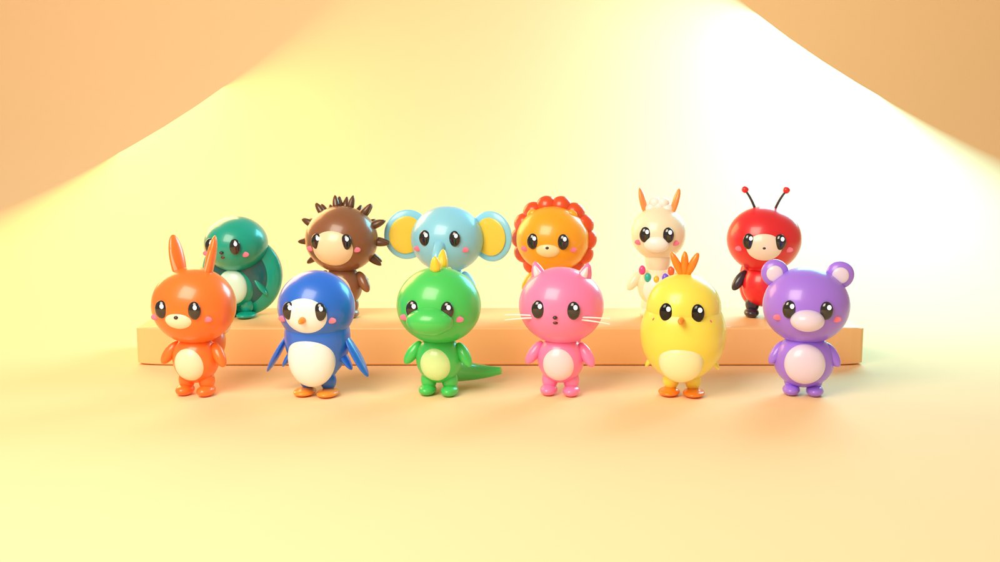

## 2. Silüet sayfası
Her pet, siyah silüetinden tek bakışta tanınmalı. İlk denemede Mavi, Kurbi, Boncuk, Tosbi ve Fifi genel "yuvarlak kafa" görünüyordu. Şu değişikliklerle ayrıştırıldılar:
- **Mavi:** yumurta biçimli tek gövde + uzun yüzgeçler.
- **Pıtı:** tek top gövde + büyük tepe püskülü.
- **Kurbi:** uzun kıvrık kuyruk + sırt plakaları.
- **Boncuk:** büyük, yüksek kulaklar + tombul göbek.
- **Tosbi:** gövdeden taşan kubbe kabuk.
- **Fifi:** yana açılan yelpaze kulaklar.

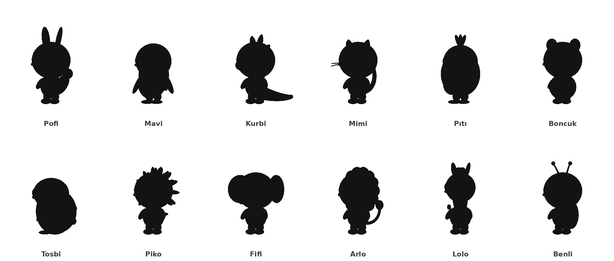

Hâlâ en zayıf iki silüet **Tosbi** ve **Benli**. Turnaround'da ayrıca iki sorun görülüyor: Tosbi'nin kabuk deseni arkadan zar gibi duruyor (nihai modelde altıgen plaka deseni olacak), Benli'nin kanat kapakları küçük kalıyor (büyütülecek). Nihai modelde güçlendirme önerileri:
- **Tosbi:** kabuk kenarında dalgalı bir taç.
- **Benli:** yarı açık kanat kapakları ile idle duruşu.

## 3. Renkler
Ayrıntılı analiz: [renk_ayrisma.md](renk_ayrisma.md). Üst sıra brief önerisi, alt sıra revize renk:

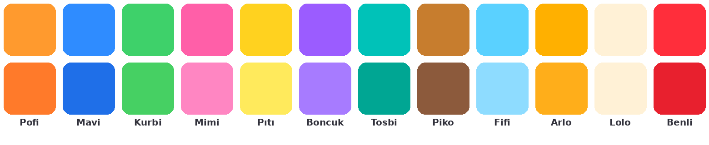

| # | Kimlik | Ad | Tür | Ana renk | Vurgu / ikinci renk | Ayırt edici özellik (silüet) |
|---|---|---|---|---|---|---|
| 1 | pet_01 | Pofi | tilki-tavşan | #FF7A2A | krem #FFE9CC, kulak içi #FFB38A | uzun, ucu yuvarlak **tavşan kulakları**; kabarık, krem uçlu **tilki kuyruğu** |
| 2 | pet_02 | Mavi | penguen | #1F6FE8 | beyaz yüz maskesi ve karın, turuncu gaga/ayak #FF9A2E | yumurta gövde, uzun yüzgeçler |
| 3 | pet_03 | Kurbi | minik dino | #46D063 | sarı plakalar #FFD23F, açık yeşil karın | sırt plakaları, kalın kıvrık kuyruk, çıkık burun |
| 4 | pet_04 | Mimi | kedi | #FF86C2 | açık pembe #FFE0EF, beyaz bıyık | üçgen kulaklar, bıyıklar, ince kıvrık kuyruk |
| 5 | pet_05 | Pıtı | civciv | #FFEA5C | turuncu gaga/püskül #FF8A1F | tek top gövde, tepe püskülü |
| 6 | pet_06 | Boncuk | ayı | #A77BFF | açık lavanta burun ve göbek #ECDFFF | büyük yuvarlak kulaklar, tombul göbek |
| 7 | pet_07 | Tosbi | deniz kaplumbağası | #00A693 | koyu kabuk #0B5E66 + açık desen #7FE3D3 | kubbe kabuk, yüzgeç el ve ayak |
| 8 | pet_08 | Piko | kirpi | #8C5A3C | krem yüz #FFE6C2, koyu dikenler #5E3A22 | yuvarlak uçlu yumuşak dikenler |
| 9 | pet_09 | Fifi | yavru fil | #8EDCFF | kulak içi sarı #FFD84A | yelpaze kulaklar, kısa kıvrık hortum |
| 10 | pet_10 | Arlo | aslan yavrusu | #FFAE1A | yele #E8501A, açık burun #FFE7B0 | yele halkası, püsküllü kuyruk |
| 11 | pet_11 | Lolo | lama | #FFF1D6 | turuncu kulaklar #FF9B54, renkli püsküller | boyun, uzun kulaklar, yün tepe |
| 12 | pet_12 | Benli | uğur böceği | #E8202E | krem yüz #FFE9D6, siyah benekler | benekli kanat kapakları, antenler |

## 4. Ön / yan / arka görünümler (turnaround)
Genç evre, ortografik. Pet döndürülür, ışık sabittir.

| | |
|---|---|
| 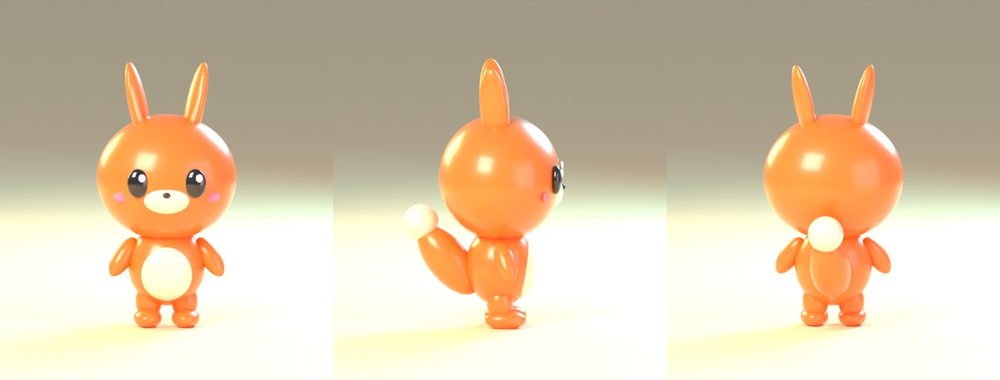 Pofi | 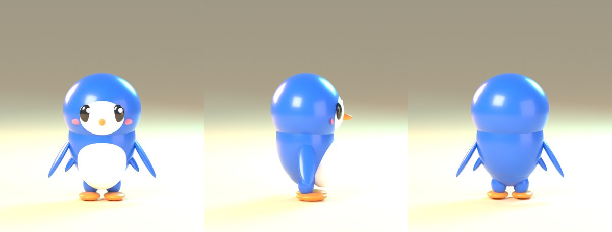 Mavi |
| 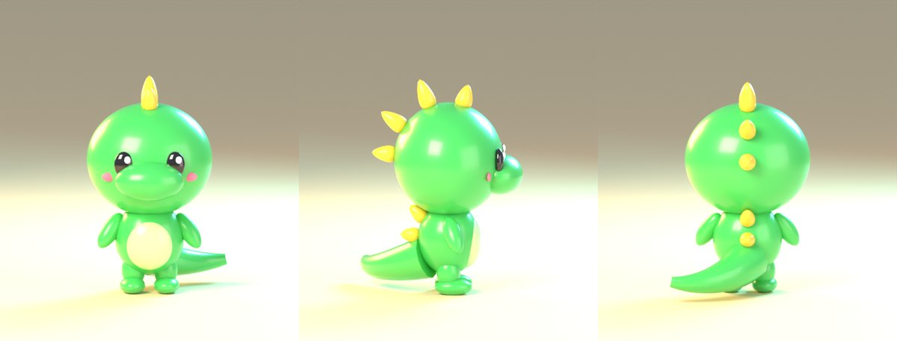 Kurbi | 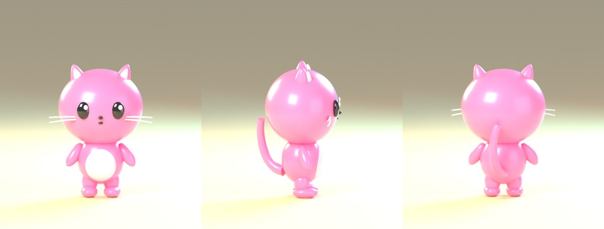 Mimi |
| 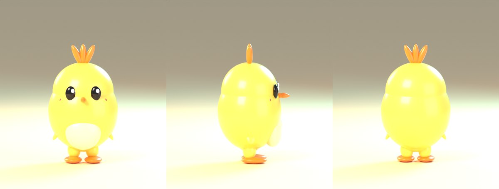 Pıtı | 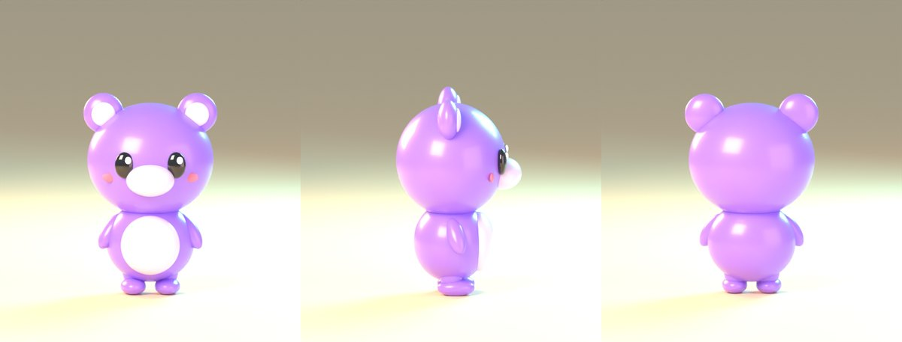 Boncuk |
| 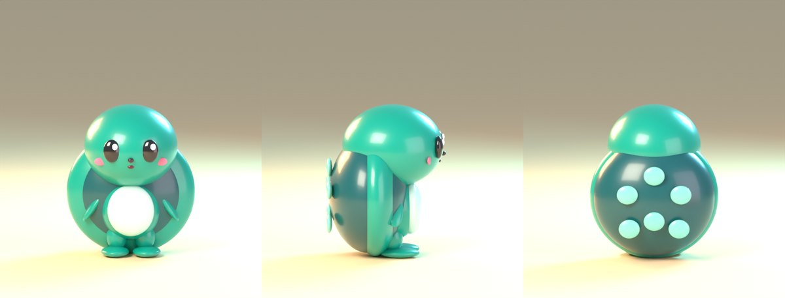 Tosbi | 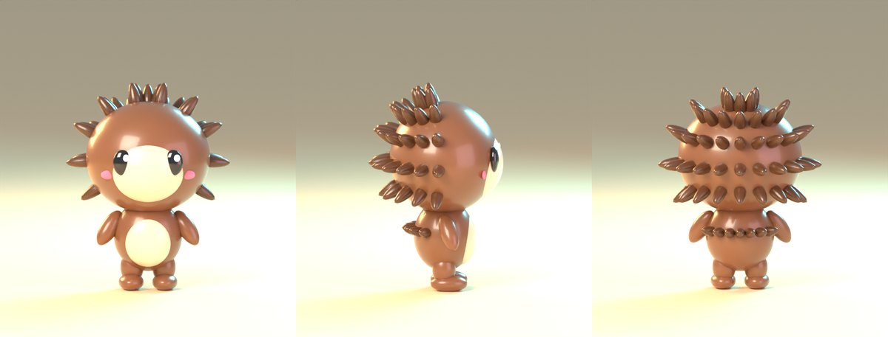 Piko |
| 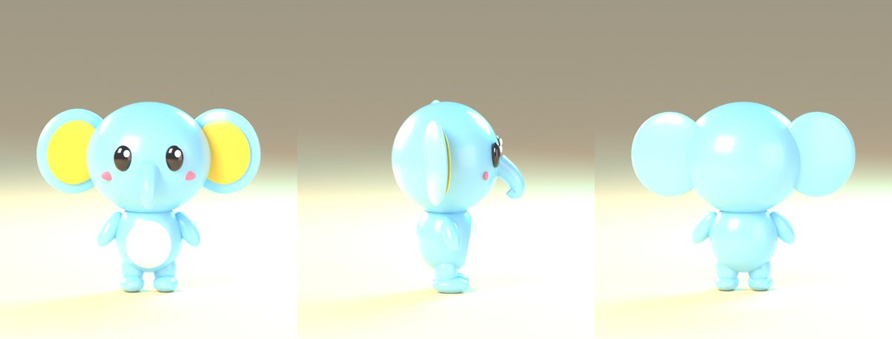 Fifi | 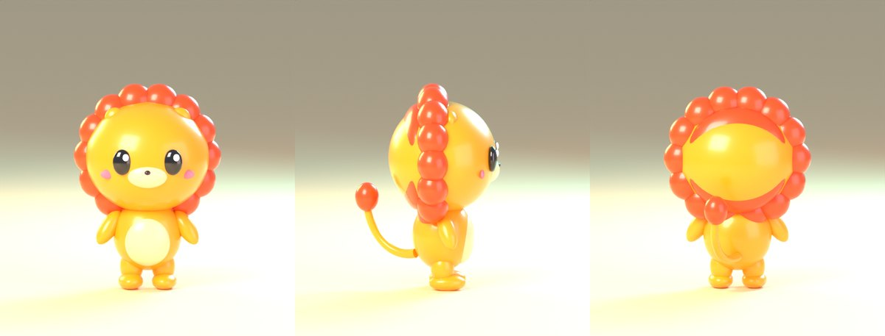 Arlo |
| 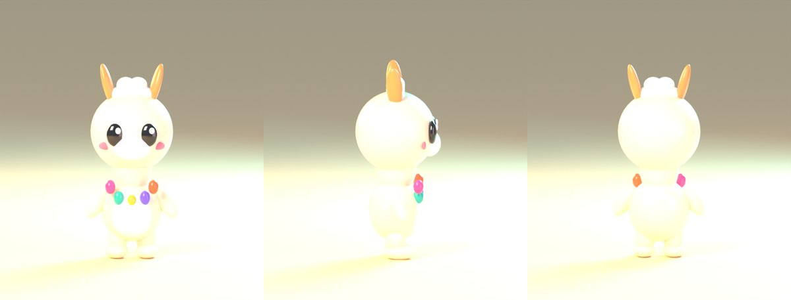 Lolo | 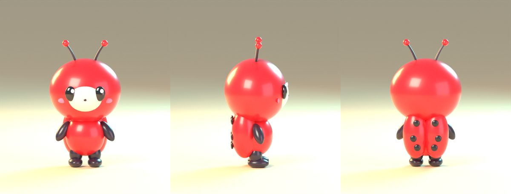 Benli |

Seçim kartı portre denemeleri (orijinalleri şeffaf arka planlı 512 px, `art/scripts/render.py hero`):

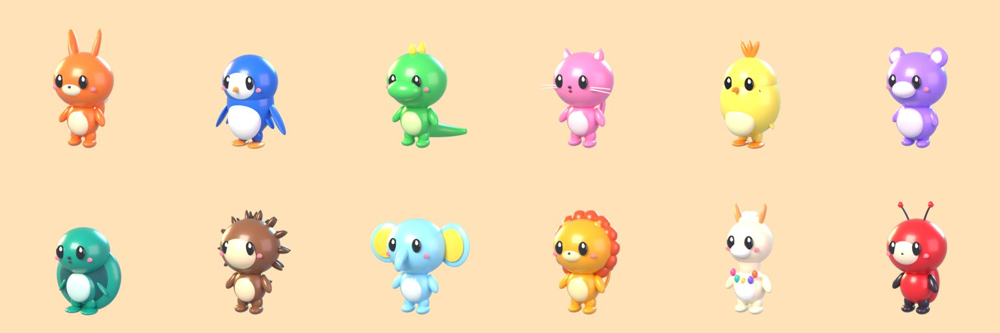

## 5. Telif kontrolü (referans görsellerle karşılaştırma)
Referanslarda bulunan türler: domuz, kurbağa, beyaz köpek/ayı, fare, iskelet maskeli kedi, kapüşonlu çocuk, jöle benzeri mavi karakter, turuncu tulumlu tilki / kırmızı panda, pembe ayı, mor yaratık.

| Pet | Risk | Önlem |
|---|---|---|
| Pofi | Turuncu tulumlu tilki karakterine yakınlık | Tilki kulağı yerine **uzun tavşan kulakları**, tulum yok, kuyrukta krem uç. Kıyafet setlerinde "tulum + kısa kollu tişört" kombinasyonundan kaçınılacak. |
| Boncuk | Referansta kahverengi ayı ve pembe ayı var | Mor-lavanta renk, büyük yüksek kulaklar, kapüşon/hırka kombinasyonu yok |
| Mimi | Referansta iskelet maskeli kedi | Maske/kapüşon yok; pembe, bıyıklı, sade kedi |
| Mavi | Referansta "jöle" mavi karakter | Net penguen silüeti (yumurta + gaga + yüzgeç), yarı saydam jöle malzeme kullanılmayacak |
| Diğerleri | Düşük | Referansta karşılığı olmayan türler |

Kural: Nihai üretimde (yapay zekâ ile 3D) **giriş görseli olarak yalnızca bizim konsept render'larımız** kullanılır. Referans görseller yapay zekâ aracına **asla** yüklenmez; bu, benzerlik riskini en aza indirir.

## 6. Kalite notu (dürüst değerlendirme)
Bu blockout'lar şunları gösterir: oran, silüet, renk, yüz yerleşimi, ayırt edici özellikler, büyüme evreleri ve soket yerleri.

Referans seviyesine ulaşmak için şunlar eksik:
- Heykel detayı (yumuşak geçişli tek parça form, kumaş kıvrımı),
- İfade (kaş, ağız şekilleri),
- Doku ve rig.

Bunlar nihai üretim hattında (yapay zekâ ile 3D + temizlik) gelecek. Üçgen sayıları bütçenin üstünde, çünkü parçalar ayrı primitifler (bkz. 0A §9).

## 7. Nihai üretim hattı önerisi (yapay zekâ ile 3D)
| Araç | Ticari kullanım | Not |
|---|---|---|
| Meshy | Ücretli planda (yaklaşık 20 $/ay, Pro) tam ticari sahiplik | Ücretsiz plan çıktıları CC BY 4.0 / değerlendirme amaçlı. **Kullanılmamalı.** |
| Tripo | Ücretli planda (yaklaşık 20 $/ay, Pro) tam ticari kullanım | Ücretsiz plan çıktıları herkese açık / kısıtlı. **Kullanılmamalı.** |

Fiyatlar ve şartlar değişebilir; satın almadan önce sağlayıcının güncel kullanım şartları okunacak.

Önerilen akış:
1. Bizim turnaround render'larımız → görselden 3D ("image-to-3D", aynı stil için aynı ışık/açı).
2. Retopoloji ve bütçe (≤ 12k), UV ve 1024 atlas.
3. Ortak iskelete bağlama ve soketler (`pets.py` şablonu).
4. Blendshape ve viseme seti.

Bilinen sınırlar:
- Yapay zekâ çıktılarında topoloji ve rig temizliği gerekir. Bunun bir kısmını Blender betikleriyle yapabilirim; yüz blendshape'leri için insan desteği gerekebilir.
- Yapay zekâ çıktısının telif koruması ülkeye göre belirsiz. Karakterlerin yeterince insan katkısı (tasarım + düzenleme) içermesi önerilir.
- Bu bulut ortamı Meshy/Tripo API'lerine şu an erişemiyor (ağ politikası). Ya sen web arayüzünde dosyaları üretip depoya yüklersin, ya da ortam ayarlarında izin verilen alan adlarına `api.meshy.ai` / `api.tripo3d.ai` eklenir ve API anahtarı ortam sırrı olarak tanımlanır.
